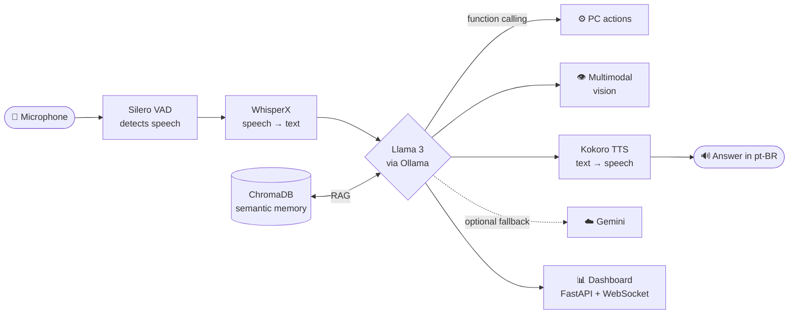

<!-- ═══════════════════════════  HEADER  ═══════════════════════════ -->

 

---

### ⏱️ 30-second summary

<table align="center">
<tr>
<td align="center" width="25%">
<h2>🎮 1</h2>
<b>multiplayer game in production</b> 
<a href="https://f1-fantasy-sala.marcosfeliperigoto.workers.dev/">play now →</a>
</td>
<td align="center" width="25%">
<h2>🧪 1,400+</h2>
<b>automated tests</b> 
Vitest + pytest
</td>
<td align="center" width="25%">
<h2>🤖 7</h2>
<b>public projects</b> 
local AI, data, games
</td>
<td align="center" width="25%">
<h2>🏥 3+</h2>
<b>years in critical support</b> 
hospital IT and SaaS
</td>
</tr>
</table>

---

## ⚡ About me

**Computer Science** student with a background in **mission-critical technical support** and a passion for **applied AI, automation and data**. I'm currently on the **Service Desk team at Callix** — a cloud contact center platform that has processed **over 1 billion calls**.

I build **local-first** projects with Python and TypeScript: voice assistants with RAG, financial analysis engines, deterministic simulation games and AI-powered productivity tools.

- 🔭 Current focus: **local AI, RAG and agents**
- 🌱 Learning: **Data Engineering** and **advanced TypeScript**
- 🤖 Pair programming with **Claude Code** — AI makes writing code faster; **architecture, domain design and testing are my decisions**

> 💡 **Principle:** systems must be reliable, documented and resilient — learned hands-on in hospital IT, where a system cannot go down.

 

---

## 🛠️ Stack

  

---

## 🚀 Projects

> 👆 Click **🔧 Technical highlights** on each card to expand the details.

<table>
<tr>
<td valign="top" width="50%">

### 🏎️ [Paddock Draft](https://github.com/Marcos-Felipe-dos-Santos/F1-fantasy)

A browser-based **Formula 1 draft and simulation game**. Build a "frankenstein car" from parts spanning **76 seasons (1950–2025)** and race an **online championship with up to 22 friends**.

<b>🔧 Technical highlights</b>

 

- **Multiplayer in production** on Cloudflare Workers + Durable Objects
- Reconnection tokens, version handshake and a **divergence detector** across clients
- **100% deterministic** engine — no `Math.random()`, everything runs on seeded RNG (survives server restarts)
- **1,094 tests** with Vitest + **mutation testing**
- **771 team/year combinations** built from real historical data (Jolpica-F1 API)
- Custom **balance harness** for large-scale simulation

`In production` · `Up to 22 players` · `5-stage championship`

</td>
<td valign="top" width="50%">

### 📈 [Sentinela B3](https://github.com/Marcos-Felipe-dos-Santos/Sentinela-B3)

Analysis of **Brazilian stocks and REITs (B3)** using official CVM data, 4 classic valuation methods (Graham, Bazin, Lynch, Gordon) and technical analysis.

<b>🔧 Technical highlights</b>

 

- **5-source cascade** with automatic fallback (CVM → brapi → yfinance → Fundamentus → Central Bank)
- **Per-source confidence score** with inline badge (🟢🟡🔴)
- Live macro data: **Selic, CDI, IPCA, NTN-B** (Central Bank + Treasury APIs)
- RSI, MACD, Bollinger Bands and interactive candlesticks
- **255 tests** with no network traffic

`255 tests` · `Educational, not financial advice`

</td>
</tr>
<tr>
<td valign="top" width="50%">

### 🧠 [PIE — Personal Intelligence Engine](https://github.com/Marcos-Felipe-dos-Santos/personal-intelligence-engine)

A **local-first** personal knowledge engine: turns unstructured text into structured data, stores it in SQLite and generates Markdown notes with a full **audit trail**.

<b>🔧 Technical highlights</b>

 

- **Layered architecture**: domain / services / adapters / repositories
- **CI with GitHub Actions** on every push
- **Versioned SQL migrations**
- **10+ ADRs** documenting decisions
- Local search, backup/export (JSON/MD)
- Experimental **Ollama** support as a local LLM

`55 commits` · `Experimental alpha`

</td>
<td valign="top" width="50%">

### 🤖 [Nina IA](https://github.com/Marcos-Felipe-dos-Santos/Nina-IA)

A **local-first** voice assistant: it listens, thinks, remembers, takes actions on the PC and answers out loud in Brazilian Portuguese — with a real-time dashboard.

<b>🔧 Technical highlights</b>

 

- Pipeline: WhisperX → Silero VAD → ChromaDB (RAG) → function calling → vision → Kokoro TTS
- **Semantic memory** with ChromaDB + sentence-transformers
- Llama 3 via Ollama (offline) or Gemini (cloud) with fallback
- **FastAPI + WebSocket** dashboard
- **Asynchronous** orchestration of every component

`CI/CD` · `Architecture below ↓`

</td>
</tr>
<tr>
<td valign="top" width="50%">

### 🛡️ [RPG Master Shield](https://github.com/Marcos-Felipe-dos-Santos/rpg-master-shield)

A **full-stack** app for tabletop RPG game masters: wiki-linked notes, maps with pins, threat clocks, faction tracking and a **safe** dice roller (no `eval`).

<b>🔧 Technical highlights</b>

 

- Separate front and back end: **FastAPI + React + TypeScript**
- **117 tests** with pytest
- Decisions recorded as **ADRs**
- MVP with **documented limitations**

`117 tests` · `Local-first`

</td>
<td valign="top" width="50%">

### 🎙️ [Podcast AI](https://github.com/Marcos-Felipe-dos-Santos/Podcast-AI)

An **autonomous** news-to-audio pipeline: collects articles via RSS, writes a script with an LLM, synthesizes speech locally and delivers it on Telegram.

<b>🔧 Technical highlights</b>

 

- **Retry with exponential backoff** and config validation
- LLM **context-limit management**
- Automatic delivery via **Telegram Bot**
- Streamlit control panel

`End-to-end pipeline` · `Kokoro TTS`

</td>
</tr>
<tr>
<td valign="top" colspan="2">

### 🧾 [Agente IR](https://github.com/Marcos-Felipe-dos-Santos/Agente_IR)

A **local-first** assistant for Brazilian income tax filing (IRPF): parses PDFs (brokerage notes, income statements, payslips), computes capital gains and uses a local LLM as an advisor. **No financial data ever leaves the machine.**

<b>🔧 Technical highlights</b>

 

- **Deterministic calculations** (average cost, loss carryforward, exemptions) + **local generative AI** (deepseek-r1:14b via Ollama)
- Defensive PDF parsing with **pdfplumber**
- **Vector PDFs** with a full calculation trail via ReportLab
- React + Vite front end; FastAPI + SQLAlchemy + Alembic back end

`Educational — not a substitute for an accountant or official tax software`

</td>
</tr>
</table>

---

## 🧩 Inside Nina IA

How a spoken sentence becomes a spoken answer — all running **on my own machine, no cloud required**:

---

## 💼 Experience

<b>🟢 Callix · Service Desk</b> &nbsp;—&nbsp; <code>Jun 2025 – Present</code>

 

Cloud **contact center SaaS** (voice, WhatsApp, SMS) with **over 1 billion calls processed**.

- Tier 1/Tier 2 support for platform users
- VoIP, omnichannel and SaaS systems support
- Ticket tracking, SLAs and documentation
- Internal automation with Python

<b>🔵 Spread Tecnologia · Tier 1/Tier 2 Support</b> &nbsp;—&nbsp; <code>Apr 2023 – Jun 2025</code>

 

Support in a **mission-critical hospital environment** (Hospital Albert Einstein, one of Latin America's leading hospitals).

- Fleet of **10,000+ assets** (desktops, workstations, servers)
- Clinical systems: PACS, RIS, Cerner, Data Import
- Remote and on-site support under SLA
- Automation with **Excel/VBA and Python**
- Hardware lab and inventory management

---

## 📊 Activity

  

<picture>
  <source media="(prefers-color-scheme: dark)" srcset="https://raw.githubusercontent.com/Marcos-Felipe-dos-Santos/Marcos-Felipe-dos-Santos/output/github-snake-dark.svg" />
  <source media="(prefers-color-scheme: light)" srcset="https://raw.githubusercontent.com/Marcos-Felipe-dos-Santos/Marcos-Felipe-dos-Santos/output/github-snake.svg" />
  
</picture>

---

### 📫 Let's talk

Happy to chat about **data, AI and automation**.

