<!-- ═══════════════════════════  HEADER  ═══════════════════════════ -->

 

---

### ⏱️ Resumo em 30 segundos

<table align="center">
<tr>
<td align="center" width="25%">
<h2>🎮 1</h2>
<b>jogo multiplayer em produção</b> 
<a href="https://f1-fantasy-sala.marcosfeliperigoto.workers.dev/">jogue agora →</a>
</td>
<td align="center" width="25%">
<h2>🧪 2.900+</h2>
<b>testes automatizados</b> 
Vitest + pytest
</td>
<td align="center" width="25%">
<h2>🤖 12</h2>
<b>projetos públicos</b> 
dados, automação, IA
</td>
<td align="center" width="25%">
<h2>🏥 3+</h2>
<b>anos em suporte crítico</b> 
TI hospitalar e SaaS
</td>
</tr>
</table>

---

## ⚡ Sobre mim

Estudante de **Ciência da Computação** com experiência em **suporte técnico crítico** e foco em **dados, BI e automação**. Hoje estou no suporte da **Callix** — plataforma brasileira de call center na nuvem usada por **mais de 800 empresas**, com **+15 milhões de chamadas e mensagens por dia**.

Construo projetos com **dados reais** em Python, SQL e TypeScript: pipelines com dados oficiais da CVM, B3 e Banco Central, extração de dados de PDFs financeiros, automações e aplicações com IA local.

- 🔭 Foco atual: **Análise de Dados, BI e Automação**
- 🌱 Estudando: **SQL avançado**, **Power BI (modelagem e DAX)** e **Engenharia de Dados**
- 🤖 Pair programming com **Claude Code** — a IA escreve código mais rápido; **arquitetura, domínio e testes são decisões minhas**

> 💡 **Princípio:** sistemas precisam ser confiáveis, documentados e resilientes — aprendido na prática em TI hospitalar, onde um sistema não pode parar.

---

## 🛠️ Stack

  

---

## 🚀 Projetos

> 👆 Clique em **🔧 Destaques técnicos** em cada card para abrir os detalhes.

<table>
<tr>
<td valign="top" width="50%">

### 📈 [Sentinela B3](https://github.com/Marcos-Felipe-dos-Santos/Sentinela-B3)

Análise de **ações e FIIs da B3** com dados oficiais da CVM, 4 métodos clássicos de valuation (Graham, Bazin, Lynch, Gordon) e análise técnica.

<b>🔧 Destaques técnicos</b>

 

- **Cascata de 5 fontes** com fallback (CVM → brapi → yfinance → Fundamentus → BCB)
- **Score de confiança** por fonte com badge inline (🟢🟡🔴)
- Macro ao vivo: **Selic, CDI, IPCA, NTN-B** (BCB + Tesouro Direto)
- RSI, MACD, Bollinger e candlestick interativo
- **255 testes** sem tráfego de rede

`255 testes` · `Educacional, não é recomendação`

</td>
<td valign="top" width="50%">

### 🏎️ [Paddock Draft](https://github.com/Marcos-Felipe-dos-Santos/F1-fantasy)

Jogo de **draft e simulação de Fórmula 1** no navegador. Monte um "carro frankenstein" com peças de **76 temporadas (1950–2025)** e dispute um campeonato **online com até 22 amigos**.

<b>🔧 Destaques técnicos</b>

 

- **Multiplayer em produção** com Cloudflare Workers + Durable Objects
- Tokens de reconexão, handshake de versão e **detector de divergência** entre clientes
- Engine **100% determinística** — zero `Math.random()`, tudo via RNG semeado (sobrevive a reinícios do servidor)
- **2.358 + 48 testes** com Vitest + **testes de mutação**
- **771 combinações** de equipe/ano a partir de dados reais (API Jolpica-F1)
- **Balance harness** próprio para simulação em massa

`Em produção` · `Até 22 jogadores` · `Campeonato em 5 etapas`

</td>
</tr>
<tr>
<td valign="top" width="50%">

### 🧠 [PIE — Personal Intelligence Engine](https://github.com/Marcos-Felipe-dos-Santos/personal-intelligence-engine)

Motor **local-first** de conhecimento pessoal: transforma texto solto em dados estruturados, persiste em SQLite e gera notas Markdown com **trilha de auditoria**.

<b>🔧 Destaques técnicos</b>

 

- **Arquitetura em camadas**: domain / services / adapters / repositories
- **CI com GitHub Actions** a cada push
- **Migrations versionadas** em SQL
- **+10 ADRs** documentando decisões
- Busca local, backup/export (JSON/MD)
- **Ollama** experimental como LLM local

`55 commits` · `Alpha experimental`

</td>
<td valign="top" width="50%">

### 🤖 [Nina IA](https://github.com/Marcos-Felipe-dos-Santos/Nina-IA)

Assistente de voz **local-first**: ouve, pensa, lembra, executa ações no PC e responde por voz em pt-BR — com dashboard em tempo real.

<b>🔧 Destaques técnicos</b>

 

- Pipeline: WhisperX → Silero VAD → ChromaDB (RAG) → function calling → visão → Kokoro TTS
- **Memória semântica** com ChromaDB + sentence-transformers
- Llama 3 via Ollama (offline) ou Gemini (cloud) com fallback
- Dashboard **FastAPI + WebSocket**
- Orquestração **assíncrona** de todos os componentes

`CI/CD` · `Arquitetura logo abaixo ↓`

</td>
</tr>
<tr>
<td valign="top" width="50%">

### 🛡️ [RPG Master Shield](https://github.com/Marcos-Felipe-dos-Santos/rpg-master-shield)

App **full-stack** para mestres de RPG: notas com wiki-links, mapas com pins, relógios de ameaça, facções e rolador de dados **seguro** (sem `eval`).

<b>🔧 Destaques técnicos</b>

 

- Front e back separados: **FastAPI + React + TypeScript**
- **117 testes** com pytest
- Decisões registradas em **ADRs**
- MVP com **limitações documentadas**

`117 testes` · `Local-first`

</td>
<td valign="top" width="50%">

### 🎙️ [Podcast AI](https://github.com/Marcos-Felipe-dos-Santos/Podcast-AI)

Pipeline **autônomo** de notícias para áudio: coleta via RSS, gera roteiro com LLM, sintetiza voz localmente e entrega no Telegram.

<b>🔧 Destaques técnicos</b>

 

- **Retry com backoff exponencial** e validação de configuração
- Gestão de **limites de contexto** do LLM
- Entrega automática via **Telegram Bot**
- Painel de controle em Streamlit

`Pipeline E2E` · `Kokoro TTS`

</td>
</tr>
<tr>
<td valign="top" colspan="2">

### 🧾 [Agente IR](https://github.com/Marcos-Felipe-dos-Santos/Agente_IR)

Apoio **local-first** à declaração de IRPF: lê PDFs (notas de corretagem, informes, holerites), calcula renda variável e usa um LLM local como conselheiro. **Nenhum dado financeiro sai da máquina.**

<b>🔧 Destaques técnicos</b>

 

- **Cálculo determinístico** (preço médio, compensação de prejuízos, isenções) + **IA generativa local** (deepseek-r1:14b via Ollama)
- Parser defensivo de PDFs com **pdfplumber**
- **PDFs vetoriais** com memória de cálculo via ReportLab
- React + Vite no front; FastAPI + SQLAlchemy + Alembic no back

`Educacional — não substitui contador nem a Receita Federal`

</td>
</tr>
</table>

---

### ➕ Mais projetos

- 🚇 [MetrôBot SP](https://github.com/Marcos-Felipe-dos-Santos/Metr-Bot-SP) — planejador de rotas do Metrô de SP com BFS/DFS, lógica de primeira ordem e narração por LLM · `146 testes`
- ⚽ [placar-futebol](https://github.com/Marcos-Felipe-dos-Santos/placar-futebol) — placar ao vivo desenhado para caber em 100 requisições de API por dia (Cloudflare Worker + KV)

---

## 🧩 Por dentro da Nina IA

Como uma frase falada vira uma resposta por voz — tudo rodando **na minha máquina, sem nuvem**:

  

---

## 💼 Experiência

<b>🟢 Callix · Service Desk</b> &nbsp;—&nbsp; <code>Jun 2025 – Presente</code>

 

Plataforma brasileira de **call center na nuvem** (Voz, Discador, WhatsApp oficial e URA Reversa) usada por **+800 empresas**, com **+15 milhões de chamadas e mensagens por dia**.

- Atendimento N1/N2 a usuários da plataforma
- Suporte a VoIP, canais omnichannel e sistemas SaaS
- Acompanhamento de chamados, SLA e documentação
- Automações internas com Python

<b>🔵 Spread Tecnologia · Suporte N1/N2</b> &nbsp;—&nbsp; <code>Abr 2023 – Jun 2025</code>

 

Suporte em **ambiente hospitalar crítico** (Hospital Albert Einstein).

- Parque de **10.000+ ativos** (desktops, workstations, servidores)
- Sistemas clínicos: PACS, RIS, Cerner, Data Import
- Atendimento remoto e presencial com SLA
- Automações com **Excel/VBA e Python**
- Laboratório de hardware e inventário

---

## 📊 Atividade

<b>⚡ O que estou fazendo agora</b> (atualizado automaticamente)

 

<!--START_SECTION:activity-->
1. 🎉 Merged PR [#29](https://github.com/Marcos-Felipe-dos-Santos/Sentinela-B3/pull/29) in [Marcos-Felipe-dos-Santos/Sentinela-B3](https://github.com/Marcos-Felipe-dos-Santos/Sentinela-B3)
2. 💪 Opened PR [#29](https://github.com/Marcos-Felipe-dos-Santos/Sentinela-B3/pull/29) in [Marcos-Felipe-dos-Santos/Sentinela-B3](https://github.com/Marcos-Felipe-dos-Santos/Sentinela-B3)
3. 🎉 Merged PR [#28](https://github.com/Marcos-Felipe-dos-Santos/Sentinela-B3/pull/28) in [Marcos-Felipe-dos-Santos/Sentinela-B3](https://github.com/Marcos-Felipe-dos-Santos/Sentinela-B3)
4. 💪 Opened PR [#28](https://github.com/Marcos-Felipe-dos-Santos/Sentinela-B3/pull/28) in [Marcos-Felipe-dos-Santos/Sentinela-B3](https://github.com/Marcos-Felipe-dos-Santos/Sentinela-B3)
5. 🎉 Merged PR [#27](https://github.com/Marcos-Felipe-dos-Santos/Sentinela-B3/pull/27) in [Marcos-Felipe-dos-Santos/Sentinela-B3](https://github.com/Marcos-Felipe-dos-Santos/Sentinela-B3)
<!--END_SECTION:activity-->

---

### 📫 Vamos conversar?

Aberto a conversas sobre **Dados, BI e Automação**.

